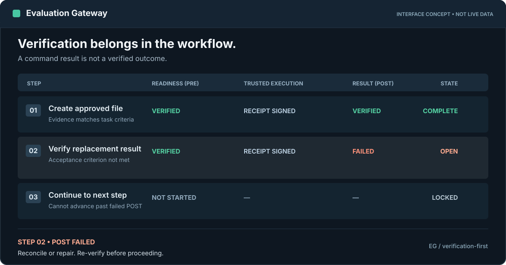
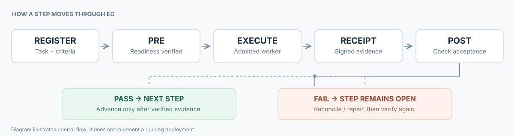

# Evaluation Gateway (EG)

## MANDATORY FROM INSTALLATION — FULL CAPABILITY ACCEPTANCE

**"Install EG completely as a generic system and test it end-to-end until every supported, authorized capability is operational."**

**Host-neutral operation:** EG can run with the existing root or non-root account. `EVALUATION_GATEWAY_LOCAL_HOST_MODE=enabled` uses the same generic, reusable E3–E5 typed worker implementation on a single host; no new per-project executor or additional OS account is mandatory. REGISTER, PRE, signed approval, actual execution receipt and POST remain required. The optional multi-identity deployment remains supported.

**Required for every fresh installation and upgrade (including staging):** Read the [canonical agent SKILL](SKILL.md) first. Inventory **E0, E2, E3, E4, and E5**. Install the EG gateway and durable audit/evidence state, configure independently protected credentials and trust roots, bring the built-in E0/E2 worker online, and provision/register/activate the **generic** E3/E4/E5 process catalog workers and independently administered scoped HITL signers for every effect class and target profile the operator has actually authorized. Verify live socket/UID identity, signed operator binding, exact typed capability match, and liveness. **Do not build project-specific executor code or infer privileges from the presence of source code.**

**Mandatory acceptance for every authorized capability:** Demonstrate the original EG **REGISTER → PRE → independently authorized execution → signed receipt → POST → VERIFIED → task SATISFIED** with a real physical effect where applicable, independent result readback, and relevant denial, replay/idempotence, crash recovery, and rollback tests. High-effect signed HITL must be valid **before PRE admission**. **CI PASS, `/health: PASS`, source/build completion, and capabilities merely listed/configured are never proof of live E2E readiness.**

**Fail-closed completion rule:** Missing independent operator approval, worker/UID, signer, scoped policy, profile, credentials, registration, or live PRE/POST evidence means the requested full installation is **INCOMPLETE / BLOCKED**, not COMPLETED. Identify the exact prerequisite; never fabricate independent authority, self-approve, or bypass EG by running the effect directly. Generic means reusable implementations with **separately authorized privileges**, not an unrestricted shell.

**Verify every step as work happens — not after a project is finished.**

[](https://github.com/kiky217/eg_portable/releases/latest)
[](https://github.com/kiky217/eg_portable/actions/workflows/release-validation.yml)
[](LICENSE)

An AI agent can finish a series of commands and still leave a project in the wrong state. **Evaluation Gateway (EG)** is an open-source system that supervises agent-driven work one step at a time: check readiness *before* execution, record what actually happened, and independently verify the result *afterward*.

A step cannot advance just because a command returned `0`, a worker reported “done,” or a deployment looked healthy. **Evidence must satisfy the step’s original acceptance criteria.**

**Development, testing, staging, recovery, and production follow the same verification rules.** Staging is not an exemption.



*Illustrative interface concept, not a screenshot of a running EG instance. All statuses and steps in the graphic are examples.*

[How it works](#how-it-works) · [Why EG](#why-eg) · [Get started](#get-started) · [Current boundaries](#current-boundaries) · [Documentation](#documentation)

## How it works

EG makes the execution boundary explicit, rather than trusting a final report.



1. **Register the task.** Define the plan, ordered steps, dependencies, and acceptance criteria.
2. **Verify readiness (PRE).** Check prerequisites, permissions, invariants, and the exact intended action.
3. **Execute through an admitted worker.** A separately trusted executor performs only a supported, authorized action and produces an independently signed receipt.
4. **Verify the outcome (POST).** Match the receipt and fresh result evidence to the *original* acceptance criteria.
5. **Advance only on verification.** A failed POST keeps the step open; reconcile or repair before moving on. An uncertain effect must not be blindly replayed.

```text
REGISTER → PRE verified → admitted execution → signed receipt
         → POST verified → NEXT STEP → task acceptance
```

A verified **step** is not the same as an accepted **task**: final acceptance also requires task-wide criteria and authenticated audit integrity.

## Why EG?

Without step-by-step verification, problems can be discovered only after an agent has already made several changes. A successful script exit cannot tell you whether the right target was changed, the evidence was sufficient, or a cutover remains recoverable.

EG helps answer practical questions while work is in progress:

| Question | What EG checks |
| --- | --- |
| Can this action start? | PRE conditions, admissible capability, permissions, and safety bounds |
| Did an authorized worker execute it? | Independent, signed execution receipt |
| Did it achieve the requested result? | POST evidence against the registered criteria |
| Can work continue? | Verified checkpoint and task ordering |
| What if a response times out? | Original gate, durable journal, receipt, and target state before any retry |
| Can a release be promoted? | Separate live admission and cutover evidence — not merely green CI |

### A failure is not a completed step

If POST fails, EG does **not** mark the step verified. If execution may have occurred but the response was lost, EG must first determine whether the effect happened. Recover an existing receipt; request a new PRE only after independently proving no effect. Leave genuinely unknown effects blocked.

This is the difference between **work performed** and **work verified**.

## What EG provides

- **Task plans and checkpoints:** ordered steps, acceptance criteria, pause/resume, and linked remediation.
- **PRE / POST verification:** distinct readiness and outcome checks, with invariants preserved across both phases.
- **Evidence binding:** task, step, phase, checkpoint, original criteria, and action-specific proof.
- **Trusted execution:** supported actions through independently admitted workers with signed receipts.
- **Recovery without blind retries:** reconcile interrupted operations against the durable execution record.
- **Authenticated audit history:** integrity checks, duplicate-event protection, and release/cutover evidence review.

These controls apply to each environment, including staging.

## Get started

**1. Read the setup guide.** EG's portable distribution targets **Linux x86-64 with CPython 3.12-compatible glibc**. Installation requires external, durable state and separately protected signing material; production credentials are not included in the archive.

- [Download a stable release](https://github.com/kiky217/eg_portable/releases/latest)
- [Portable installation and operations runbook](eg/docs/PORTABLE_RUNBOOK.md)

The offline distribution also bundles the root `SKILL.md`, README, security
policy, license and referenced workflow diagrams; linked historical archives
remain available from the canonical GitHub repository.

**2. Check what your environment can actually do.** For an agent integration, start with the complete [operational SKILL.md](SKILL.md), the [source-verified agent operations reference](eg/docs/AGENT_OPERATIONS_REFERENCE.md), and the [agent quickstart](eg/docs/AGENT_QUICKSTART.md). A local, read-only preflight can be run from the repository root:

```sh
python eg/tools/agent_readiness.py --effect E2 --action write
```

This preflight is **not** execution authorization. The evaluator defaults to
`EVALUATION_GATEWAY_ADMISSION_MODE=enabled` when unset; this flag does not
provision any worker. A live instance can have health and audit `PASS` while
all effects are `UNAVAILABLE` until an independently trusted executor is
admitted. For audit-only exceptions and bootstrap restrictions, see the
[operations guide](eg/docs/OPERATIONS.md#safe-historical-task-migration).
Production readiness requires fresh, authenticated live state and a separately
trusted executor.

**3. Learn the contracts before admitting effects.** The [executor protocol](eg/docs/EXECUTOR_PROTOCOL.md) describes PRE, signed receipts, POST, and evidence requirements. For development and isolated regression testing, see the [application and developer guide](eg/README.md#build-and-test).

For a signed provider-neutral process example, see `eg/tests/test_process_external_e2e.py` and [Generic execution model](eg/docs/GENERIC_EXECUTION_MODEL.md). One generic worker can serve many independently approved task targets.

## Current boundaries

EG is a **generic, provider-neutral work governance system**, not a remote root shell. Preapproved catalog profiles can serve many projects without adding code for each tool or provider.

| Execution scope | Current support |
| --- | --- |
| **E0** bounded reads | Bundled trusted worker |
| **E1** | Not implemented; rejected from new capability discovery and action input. Do not count as installed. |
| **E2** reversible file creation and SHA-256-bound replacement | Bundled trusted worker, restricted output directory and allowlisted suffixes |
| **E3–E5** higher-effect operations | Generic typed worker under exact signed operator policy; single-host root/non-root mode supported, without per-project executor |
| **E3 bounded processes** | Reuse signed, operator-approved process catalog profiles; no project-specific executor or mandatory new OS account |
| **E4/E5 bounded typed operations** | The **same** independently provisioned process-catalog implementation supports E4 and E5 with operator-pinned effect/action profile, separate signed scope and PRE/HITL/POST. E4 reversible, E5 irreversible; no arbitrary shell or implicit new privileges |

The E3–E5 disposable adapters included for repository tests are **CI fixtures, not production executors**. Human approval alone cannot create a missing execution capability. EG also cannot enforce actions performed entirely outside its trusted boundary.

**Generic evidence provenance:** Evidence producer names are validated as
bounded `*_task` labels; an unfamiliar or historical label is not a
capability or trust grant. Only an independently signed manifest-v4 with
matching criterion, phase, checkpoint, timestamp and trusted root can
establish evidence. The user-defined task/provider does not select executor
code. See [the SKILL operational cookbook](SKILL.md#provider-neutral-operational-cookbook-normative-for-new-work)
and [generic execution model](eg/docs/GENERIC_EXECUTION_MODEL.md).

**A passing release workflow proves source validation, not a live production deployment.** See [production promotion](eg/docs/PRODUCTION_PROMOTION.md) for the additional runtime and cutover gates.

## Documentation

| Start here | Covers |
| --- | --- |
| [Portable runbook](eg/docs/PORTABLE_RUNBOOK.md) | Installation, daily operation, staging, recovery, and rollback |
| [Agent SKILL](SKILL.md) | Discover, register, PRE, dispatch once, recover, POST, and finalize |
| [Agent operations reference](eg/docs/AGENT_OPERATIONS_REFERENCE.md) | Actual API, typed workers, recovery and common blockers |
| [Agent quickstart](eg/docs/AGENT_QUICKSTART.md) | Readiness checks, admitted capabilities, and safe agent usage |
| [Executor protocol](eg/docs/EXECUTOR_PROTOCOL.md) | Exact PRE/POST contracts, evidence, and receipts |
| [Generic execution model](eg/docs/GENERIC_EXECUTION_MODEL.md) | One multi-target process catalog shared across projects and environments |
| [Independent E3 process worker](eg/docs/OPERATOR_PROCESS_SERVICE.md) | One-time operator provisioning for reusable fixed-operation profiles |
| [Architecture](eg/docs/UNIFIED_ARCHITECTURE.md) | Components, isolation, and trust boundaries |
| [Remediation protocol](eg/docs/REMEDIAL_PROTOCOL.md) | Failure handling and controlled repair |
| [Production promotion](eg/docs/PRODUCTION_PROMOTION.md) | Software release versus live production readiness |
| [Developer guide](eg/README.md) | Source layout, build, and test instructions |
| [Security policy](SECURITY.md) | Reporting security concerns |

## Contributing

Found a bug or a missing execution capability? [Open an issue](https://github.com/kiky217/eg_portable/issues) with the expected behavior, actual behavior, and reproducible evidence. Pull requests should preserve the existing verification boundaries and pass repository regression and E2E checks.

EG is released under the [MIT License](LICENSE).

---

**The rule is simple: work is not accepted because it happened. It is accepted because it was verified.**
